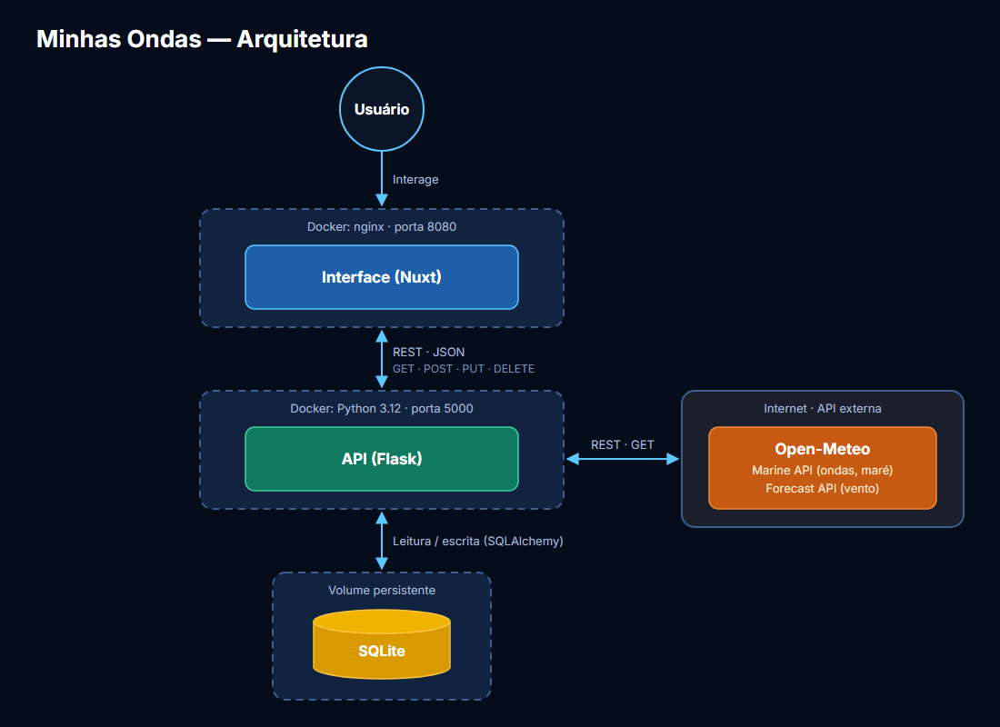

# Minhas Ondas — Interface

Interface do **Minhas Ondas**, um painel para monitorar as condições de surf dos seus
picos favoritos e descobrir o melhor lugar para ir. Construída em **Nuxt** com
**Tailwind CSS**, consome a [Minhas Ondas API](https://github.com/ericopuc/minhas-ondas-api),
que coleta os dados da **Open-Meteo** e calcula o score de qualidade de cada pico.

Faz parte de um sistema com três módulos:

| Módulo | Repositório |
|--------|-------------|
| Interface (este) | [minhas-ondas-front](https://github.com/ericopuc/minhas-ondas-front) |
| API principal | [minhas-ondas-api](https://github.com/ericopuc/minhas-ondas-api) |
| API externa | [Open-Meteo](https://open-meteo.com/), consumida pela API principal (detalhes no README da API) |

## Arquitetura



- O usuário interage **somente com a interface**, que se comunica com a API principal via
  REST/JSON (GET, POST, PUT e DELETE).
- A API externa (Open-Meteo) é consultada **somente pela API principal**, que também é a
  única a acessar o SQLite.
- Por ser uma SPA, as chamadas partem do JavaScript da interface executado no navegador;
  por isso a API precisa estar acessível na porta `5000` do host.

## Funcionalidades

- **Mapa** (Leaflet + OpenStreetMap) com um pin circular por pico, colorido pelo score
  atual — gradiente vermelho → amarelo → verde.
- **Lista de picos** fixa no primeiro momento (agora, entre 6h e 16h; fora disso, o próximo
  horário de interesse), com ondulação, período, direção, vento, maré, temperatura da água e
  um **mini-gráfico de tendência** do score nas próximas 12 horas, indicando se vai melhorar,
  piorar ou ficar estável até o próximo horário de interesse.
- **Melhor pico para ir**, sempre relativo aos horários de interesse (6h, 10h, 14h e 18h):
  antes das 6h mostra os horários de hoje; das 6h às 16h, o horário atual e os próximos;
  depois das 16h, os horários de amanhã a partir das 6h. Em seguida vêm a manhã e a tarde do
  dia seguinte e a manhã do outro dia. Um seletor troca o horário.
- **Detalhe do pico**: métricas atuais, notas do score, gráfico da **evolução do score**,
  gráfico da **tábua de maré** e **tabela com todos os dados** coletados — horas em colunas,
  todos os dias num único scroll horizontal e botões de dia que funcionam como âncoras.
- **Cadastro, edição e remoção** de picos: a posição é marcada clicando no mapa e as
  direções preferidas são escolhidas em **seletores giratórios** (arraste, clique no ponto
  cardeal ou use as setas do teclado).

Chamadas à API por método HTTP:

| Método | Rota | Onde é usada |
|--------|------|--------------|
| `GET` | `/picos`, `/pico?id=`, `/ranking?momento=` | Mapa, lista, detalhe e resumo |
| `POST` | `/pico` | Formulário de novo pico |
| `PUT` | `/pico?id=` | Formulário de edição |
| `DELETE` | `/pico?id=` | Botão de remover (com confirmação) |

## Tecnologias

- **Nuxt 4** (Vue 3), em modo SPA (`ssr: false`)
- **Tailwind CSS 4**
- **Leaflet** (mapa) e **Chart.js** + **vue-chartjs** (gráficos)
- **Docker** + **nginx**

## Pré-requisitos

- [Node.js 22+](https://nodejs.org/) e `npm`, **ou**
- [Docker](https://docs.docker.com/get-docker/)
- A **Minhas Ondas API** rodando em `http://127.0.0.1:5000` (ver o README da API)

## Instalação e execução local

**1. Clone o repositório e acesse a pasta do projeto:**

```bash
git clone https://github.com/ericopuc/minhas-ondas-front.git
cd minhas-ondas-front
```

**2. Instale as dependências:**

```bash
npm install
```

**3. (Opcional) Endereço da API:** se a API não estiver em `http://127.0.0.1:5000`, copie
`.env.example` para `.env` e ajuste `NUXT_PUBLIC_API_URL`.

**4. Inicie o servidor de desenvolvimento:**

```bash
npm run dev
```

Acesse [http://localhost:3000](http://localhost:3000).

Para gerar os arquivos estáticos de produção (pasta `.output/public`):

```bash
npm run generate
```

## Execução com Docker

A imagem compila o projeto com Node e serve o resultado com nginx:

```bash
# construir a imagem
docker build -t minhas-ondas-front .

# executar
docker run -d --name minhas-ondas-front -p 8080:80 minhas-ondas-front
```

Acesse [http://localhost:8080](http://localhost:8080). A API precisa estar no ar na porta
`5000` (o navegador a acessa diretamente). Para outro endereço, informe-o no build:

```bash
docker build --build-arg NUXT_PUBLIC_API_URL=http://meu-servidor:5000 -t minhas-ondas-front .
```

## Estrutura

```
minhas-ondas-front/
├── app/
│   ├── app.vue              # Tela principal: estado e orquestração
│   ├── assets/css/main.css  # Tailwind e paleta (tons de azul-escuro e branco)
│   ├── components/          # MapaPicos, ListaPicos, ResumoMelhor, DetalhePico,
│   │                        # FormularioPico, SeletorDirecao, GraficoMare, GraficoScore...
│   ├── composables/useApi.js  # Uma função por operação HTTP da API
│   └── utils/               # Formatação (cores do score, pontos cardeais) e gráficos
├── public/                  # Arquivos estáticos (favicon)
├── docs/                    # Fluxograma da arquitetura
├── nuxt.config.ts
├── Dockerfile
└── package.json
```

## Créditos dos dados

- Dados de clima e mar: [Open-Meteo.com](https://open-meteo.com/) — [CC BY 4.0](https://creativecommons.org/licenses/by/4.0/)
- Mapa: © [colaboradores do OpenStreetMap](https://www.openstreetmap.org/copyright)
